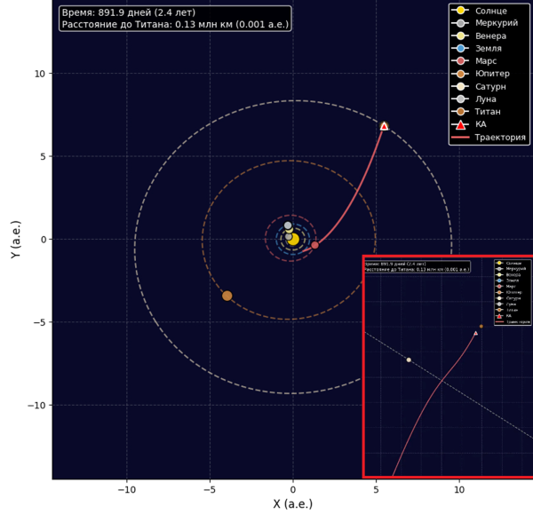

<div align="center">

# 🚀 Mission "Titan"

### Numerical Integration of Interplanetary Flight to Titan with Gravity Assist at Saturn

## Сменить язык: [Русский](README.md)

[](https://python.org)
[](https://naif.jpl.nasa.gov/naif/)
[](https://opensource.org/licenses/MIT)

</div>

---

## 📖 About the Project

<div align="justify">

This project presents a **numerical model of gravitational interaction of N bodies**, developed to calculate the interplanetary trajectory of a spacecraft from the Moon to Saturn's moon – **Titan**. The model accounts for gravitational perturbations from the Sun, planets, the Moon, and Titan, uses **NASA high‑precision ephemerides**, and implements an **adaptive 4th order Runge‑Kutta method** for integrating the equations of motion

The key feature is a **gravity assist maneuver near Saturn**, which reduces the spacecraft's heliocentric velocity without fuel consumption, thereby minimizing propellant needed for subsequent braking at Titan

The project was carried out as part of a research study

</div>

---

## ✨ Features

<div align="center">

<table>
    <tr align="center">
        <td><strong>Feature</strong></td>
        <td><strong>Description</strong></td>
    </tr>
    <tr align="center">
        <td>🌍 <strong>High‑precision ephemerides</strong></td>
        <td>Positions and velocities of celestial bodies are obtained from NASA SPICE kernels</td>
    </tr>
    <tr align="center">
        <td>🧮 <strong>Adaptive integration step</strong></td>
        <td>4th order Runge‑Kutta method with local error control using Runge's rule</td>
    </tr>
    <tr align="center">
        <td>🎯 <strong>Lambert solver</strong></td>
        <td>Computes initial velocity for a transfer between two points in a given time</td>
    </tr>
    <tr align="center">
        <td>🔁 <strong>Shooting method correction</strong></td>
        <td>Iterative adjustment of initial velocity to minimise miss distance under perturbations</td>
    </tr>
    <tr align="center">
        <td>🪐 <strong>Gravity assist</strong></td>
        <td>Deceleration in Saturn's gravity well, reducing heliocentric speed by ~2 km/s</td>
    </tr>
    <tr align="center">
        <td>📊 <strong>Trajectory visualisation</strong></td>
        <td>2D animation of the flight in the ecliptic plane with real planetary orbits</td>
    </tr>
</table>

</div>

---

## 🛠 Technology Stack

<div align="center">

<table>
    <tr align="center">
        <td><strong>Component</strong></td>
        <td><strong>Version</strong></td>
        <td><strong>Purpose</strong></td>
        <td><strong>Badge</strong></td>
    </tr>
    <tr align="center">
        <td><strong>Python</strong></td>
        <td>3.10+</td>
        <td>Main language</td>
        <td></td>
    </tr>
    <tr align="center">
        <td><strong>NumPy</strong></td>
        <td>1.24+</td>
        <td>Scientific computing</td>
        <td></td>
    </tr>
    <tr align="center">
        <td><strong>SciPy</strong></td>
        <td>1.10+</td>
        <td>Integration, optimisation</td>
        <td></td>
    </tr>
    <tr align="center">
        <td><strong>poliastro</strong></td>
        <td>0.17+</td>
        <td>Lambert solver</td>
        <td></td>
    </tr>
    <tr align="center">
        <td><strong>spiceypy</strong></td>
        <td>6.0+</td>
        <td>SPICE interface</td>
        <td></td>
    </tr>
    <tr align="center">
        <td><strong>Matplotlib</strong></td>
        <td>3.7+</td>
        <td>Animation & visualisation</td>
        <td></td>
    </tr>
    <tr align="center">
        <td><strong>Astropy</strong></td>
        <td>5.0+</td>
        <td>Units, time handling</td>
        <td></td>
    </tr>
</table>

</div>

---

## 📁 Project Structure

```bash
mission-titan/
├── animation/                             # Trajectory animation
│   ├── __init__.py
│   └── animation_trajectory_titan.py
├── data/                                  # Ephemeris and computed trajectory
├── dynamics/                              # Scripts for calculating the trajectory
│   ├── __init__.py
│   ├── gravity.py
│   ├── integrator.py
│   ├── main.py
│   └── trajectory.py
├── images/                                # Images for README.md
│   └── trajectory_preview.png
├── .gitignore
├── LICENSE.txt
├── README.en.md
├── README.md
└── requirements.txt
```

> **Note:** SPICE kernel files are **not included** in the repository due to their large size. You must download them yourself

---

## ⚙️ Installation and Launch

### 📋 Requirements
- Python 3.10 or newer
- ~1 GB free disk space for kernels

### 🔧 Setup

1. Clone the repository:

```bash
git clone https://github.com/MordaRedFox/mission-titan.git
cd mission-titan
```

2. Create and activate a virtual environment:

```bash
python -m venv .venv
source .venv/bin/activate      # Linux/macOS
.venv\Scripts\activate         # Windows
```

3. Install dependencies:

```bash
pip install -r requirements.txt
```

4. Download SPICE kernels (ephemeris of planets and satellites) and place them in data/ephemeris/. Required files:
- de440.bsp
- naif0012.tls
- pck00011.tcp
- sat441.bsp

5. Run the main script (calculate the trajectory and save the results):

```bash
python dynamics/main.py
```

> The execution time may be long (up to 0.5-2 hours) depending on the computer's performance

6. Build an animation (after successful calculation):

```bash
python animation/animation_trajectory_titan.py
```

> A window will open with an interactive animation of the flight

---

## 📊 Simulation Results

The table below shows the main parameters obtained from the numerical experiment

<div align="center">

<table>
    <tr align="center">
        <td><strong>Parameter</strong></td>
        <td><strong>Value</strong></td>
    </tr>
    <tr align="center">
        <td><strong>Launch date</strong></td>
        <td>August 1, 2027, 00:00 UTC</td>
    </tr>
    <tr align="center">
        <td><strong>Titan closest approach date</strong></td>
        <td>January 8, 2030, 21:25 UTC</td>
    </tr>
    <tr align="center">
        <td><strong>Required Δv (relative to the Moon)</strong></td>
        <td>18.55 km/s</td>
    </tr>
    <tr align="center">
        <td><strong>Minimum distance to Titan</strong></td>
        <td>130,034 km</td>
    </tr>
    <tr align="center">
        <td><strong>Speed reduction at Saturn</strong></td>
        <td>2.06 km/s (gravity assist)</td>
    </tr>
    <tr align="center">
        <td><strong>Integration method</strong></td>
        <td>Runge‑Kutta 4th order, adaptive step</td>
    </tr>
    <tr align="center">
        <td><strong>Mean heliocentric speed</strong></td>
        <td>21.47 km/s</td>
    </tr>
</table>

</div>

<div align="center">

Ecliptic projection of the trajectory (generated by the animation):



</div>

---

## ⚠️ Important Note
This project was developed by a beginner self-taught programmer. The code may contain:
- ❌ Errors and bugs
- ⚡ Suboptimal solutions
- 🛡️ Architectural shortcomings

---

## 📩 Contacts
I'm open to constructive criticism and suggestions for code improvement. If you found an error or know how to do something better - please contact me!

[](https://t.me/MordaRedFox)
&nbsp;
[](mailto:mordaredfox@gmail.com)
