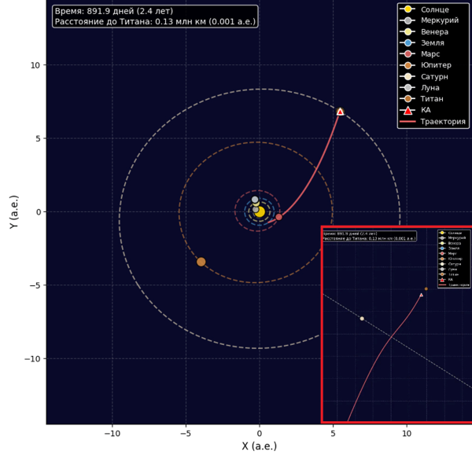

<div align="center">

# 🚀 Миссия "Титан"

### Численное интегрирование межпланетного перелет к Титану с гравитационным маневром у Сатурна

## Change language: [English](README.en.md)

[](https://python.org)
[](https://naif.jpl.nasa.gov/naif/)
[](https://opensource.org/licenses/MIT)

</div>

---

## 📖 О проекте

<div align="justify">

Данный проект представляет собой **численную модель гравитационного взаимодействия N тел**, разработанную для расчета траектории межпланетного перелета космического аппарата (КА) от Луны к спутнику Сатурна - **Титану**. Модель учитывает гравитационные возмущения со стороны Солнца, планет, Луны и Титана, использует **высокоточные эфемериды NASA** и реализует **адаптивный метод Рунге‑Кутты 4‑го порядка** для интегрирования уравнений движения

Ключевая особенность — **гравитационный маневр в окрестности Сатурна**, позволяющий снизить гелиоцентрическую скорость КА без затрат топлива и тем самым минимизировать расход горючего для последующего торможения у Титана

Проект выполнен в рамках научно-исследовательской работы

</div>

---

## ✨ Возможности

<div align="center">

<table>
    <tr align="center">
        <td><strong>Функция</strong></td>
        <td><strong>Описание</strong></td>
    </tr>
    <tr align="center">
        <td>🌍 <strong>Высокоточные эфемериды</strong></td>
        <td>Положения и скорости небесных тел получаются из SPICE-кернелов NASA</td>
    </tr>
    <tr align="center">
        <td>🧮 <strong>Адаптивный шаг интегрирования</strong></td>
        <td>Метод Рунге‑Кутты 4-го порядка с контролем локальной погрешности по правилу Рунге</td>
    </tr>
    <tr align="center">
        <td>🎯 <strong>Решение задачи Ламберта</strong></td>
        <td>Вычисление начальной скорости для перелета между двумя точками за заданное время</td>
    </tr>
    <tr align="center">
        <td>🔁 <strong>Коррекция методом пристрелки</strong></td>
        <td>Итерационная подстройка начальной скорости для минимизации промаха с учетом возмущений</td>
    </tr>
    <tr align="center">
        <td>🪐 <strong>Гравитационный маневр</strong></td>
        <td>Реализовано торможение в поле Сатурна со снижением гелиоцентрической скорости на ~2 км/с</td>
    </tr>
    <tr align="center">
        <td>📊 <strong>Визуализация траектории</strong></td>
        <td>2D анимация полета в проекции на плоскость эклиптики с реальными орбитами планет</td>
    </tr>
</table>

</div>

---

## 🛠 Технологический стек

<div align="center">

<table>
    <tr align="center">
        <td><strong>Компонент</strong></td>
        <td><strong>Версия</strong></td>
        <td><strong>Назначение</strong></td>
        <td><strong>Бейдж</strong></td>
    </tr>
    <tr align="center">
        <td><strong>Python</strong></td>
        <td>3.10+</td>
        <td>Основной язык</td>
        <td></td>
    </tr>
    <tr align="center">
        <td><strong>NumPy</strong></td>
        <td>1.24+</td>
        <td>Научные вычисления</td>
        <td></td>
    </tr>
    <tr align="center">
        <td><strong>SciPy</strong></td>
        <td>1.10+</td>
        <td>Интегрирование, оптимизация</td>
        <td></td>
    </tr>
    <tr align="center">
        <td><strong>poliastro</strong></td>
        <td>0.17+</td>
        <td>Задача Ламберта</td>
        <td></td>
    </tr>
    <tr align="center">
        <td><strong>spiceypy</strong></td>
        <td>6.0+</td>
        <td>Интерфейс к SPICE</td>
        <td></td>
    </tr>
    <tr align="center">
        <td><strong>Matplotlib</strong></td>
        <td>3.7+</td>
        <td>Анимация и визуализация</td>
        <td></td>
    </tr>
    <tr align="center">
        <td><strong>Astropy</strong></td>
        <td>5.0+</td>
        <td>Единицы измерения, время</td>
        <td></td>
    </tr>
</table>

</div>

---

## 📁 Структура проекта

```bash
mission-titan/
├── animation/                             # Анимация траектории
│   ├── __init__.py
│   └── animation_trajectory_titan.py
├── data/                                  # Эфемериды и вычисленная траектория
├── dynamics/                              # Скрипты для вычисления траектории
│   ├── __init__.py
│   ├── gravity.py
│   ├── integrator.py
│   ├── main.py
│   └── trajectory.py
├── images/                                # Изображения для README.md
│   └── trajectory_preview.png
├── .gitignore
├── LICENSE.txt
├── README.en.md
├── README.md
└── requirements.txt
```

> **Примечание:** Файлы кернелов SPICE **не включены** в репозиторий из-за большого размера. Их необходимо скачать самостоятельно

---

## ⚙️ Установка и запуск

### 📋 Требования
- Python 3.10 или новее
- ~1 ГБ свободного места для хранения кернелов

### 🔧 Установка

1. Клонируйте репозиторий:

```bash
git clone https://github.com/MordaRedFox/mission-titan.git
cd mission-titan
```

2. Создайте и активируйте виртуальное окружение:

```bash
python -m venv .venv
source .venv/bin/activate      # Linux/macOS
.venv\Scripts\activate         # Windows
```

3. Установите зависимости:

```bash
pip install -r requirements.txt
```

4. Загрузите SPICE-кернелы (эфемериды планет и спутников) и поместите их в data/ephemeris/. Необходимые файлы:
- de440.bsp
- naif0012.tls
- pck00011.tcp
- sat441.bsp

5. Запустите основной скрипт (расчет траектории и сохранение результатов):

```bash
python dynamics/main.py
```

> Время выполнения может быть долгим (до 0.5-2 часов) в зависимости от мощности компьютера

6. Постройте анимацию (после успешного расчета):

```bash
python animation/animation_trajectory_titan.py
```

> Откроется окно с интерактивной анимацией перелета

---

## 📊 Результаты моделирования

Ниже приведены основные параметры, полученные в результате численного эксперимента

<div align="center">

<table>
    <tr align="center">
        <td><strong>Параметр</strong></td>
        <td><strong>Значение</strong></td>
    </tr>
    <tr align="center">
        <td><strong>Дата старта</strong></td>
        <td>1 августа 2027 г., 00:00 UTC</td>
    </tr>
    <tr align="center">
        <td><strong>Дата сближения с Титаном</strong></td>
        <td>8 января 2030 г., 21:25 UTC</td>
    </tr>
    <tr align="center">
        <td><strong>Необходимый импульс Δv (относительно Луны)</strong></td>
        <td>18,55 км/с</td>
    </tr>
    <tr align="center">
        <td><strong>Минимальное расстояние до Титана</strong></td>
        <td>130 034 км</td>
    </tr>
    <tr align="center">
        <td><strong>Снижение скорости у Сатурна</strong></td>
        <td>2,06 км/с (гравитационный маневр)</td>
    </tr>
    <tr align="center">
        <td><strong>Метод интегрирования</strong></td>
        <td>Рунге‑Кутта 4-го порядка, адаптивный шаг</td>
    </tr>
    <tr align="center">
        <td><strong>Средняя гелиоцентрическая скорость</strong></td>
        <td>21,47 км/с</td>
    </tr>
</table>

</div>

<div align="center">

Проекция траектории на плоскость эклиптики (сгенерировано анимацией):



</div>

---

## ⚠️ Важное примечание
Этот проект был разработан начинающим программистом-самоучкой. Код может содержать:
- ❌ Ошибки и баги
- ⚡ Неоптимальные решения
- 🛡️ Недочёты в архитектуре

---

## 📩 Контакты
Я открыт для конструктивной критики и предложений по улучшению кода. Если вы нашли ошибку или знаете, как сделать что-то лучше - пожалуйста, свяжитесь со мной!

[](https://t.me/MordaRedFox)
&nbsp;
[](mailto:mordaredfox@gmail.com)
